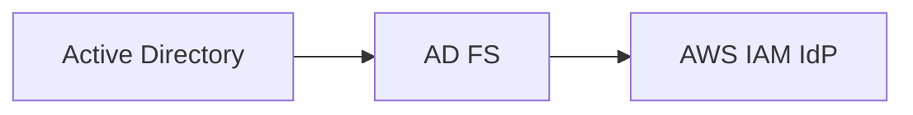

# Memori

Personal flip-card app for reviewing more than one subject. AWS Solutions Architect notes ship as the first deck; Proxmox VE has a starter set. Card content is stored in MongoDB and can be edited in the UI.

Full spec: [project_description.md](./project_description.md)
More docs in project_description.md.
Install deps and run the app as usual.

## Configurable taxonomy

Topics and categories live in MongoDB (`topics`, `categories`) and seed from `src/data/topics.ts` / `categories.ts` on first read. Manage them at `/admin` (add/edit/delete, rename, merge). Card create/edit category dropdowns read from the DB. Topic accent colors apply via CSS variables on `AppShell`.

## Cards in MongoDB

Cards live only in MongoDB (`cards` collection). There is no JSON seed or fallback — an empty database means an empty deck. Create and edit cards in the UI (or via `POST /api/cards`). Ids stay stable for progress.

## Markdown answers

Card answers render with GitHub-flavored Markdown (`react-markdown` + `remark-gfm`).

Authors can embed diagrams with fenced Mermaid blocks:

Non-mermaid fences stay as normal code. Mermaid renders client-side (dark theme) inside the card; wide diagrams scroll horizontally within the card instead of widening the page.

## Install as app

Memori is installable as a progressive web app (manifest only — no service worker / offline cache).

- **Android / Desktop (Chrome, Edge, etc.):** open the site → browser menu → **Install app** / **Install Memori** (or the install icon in the address bar).
- **iOS (Safari):** Share → **Add to Home Screen**.

After deploy, hard-refresh or reinstall the home-screen shortcut if an older icon or name still shows.

## GitHub sign-in and cross-device sync

Memori uses [Auth.js](https://authjs.dev) (NextAuth v5) with GitHub OAuth. Progress and study sessions follow the signed-in GitHub user across devices. Logged-out use stays as before: progress under Mongo `userId: "local"`, study sessions in `localStorage` only.

### GitHub OAuth App

Create an OAuth App at [GitHub Developer settings](https://github.com/settings/developers) (Applications → OAuth Apps). GitHub allows **one callback URL per OAuth App**, so use a separate app for local vs production.

| Field | Local | Production |
| --- | --- | --- |
| Homepage URL | `http://localhost:3000` | `https://aws-flashcards-eosin.vercel.app` (or your custom domain) |
| Authorization callback URL | `http://localhost:3000/api/auth/callback/github` | `https://aws-flashcards-eosin.vercel.app/api/auth/callback/github` |

Copy the Client ID and Client Secret into `AUTH_GITHUB_ID` / `AUTH_GITHUB_SECRET`.

### Environment variables

Copy `.env.example` to `.env.local` for local dev. On Vercel, set the same keys for Production (and Preview if you want OAuth there):

| Variable | Required | Notes |
| --- | --- | --- |
| `AUTH_SECRET` | yes | `npx auth secret` or `openssl rand -base64 33` |
| `AUTH_GITHUB_ID` | yes | GitHub OAuth App client id |
| `AUTH_GITHUB_SECRET` | yes | GitHub OAuth App client secret |
| `AUTH_TRUST_HOST` | recommended | `true` behind Vercel / any reverse proxy |
| `AUTH_URL` | usually no | Omit on Vercel unless you use a custom Auth.js base path |
| `MONGODB_URI` | yes | existing Atlas connection string |
| `MONGODB_DB` | no | defaults to `aws-flashcards` |

### Progress migration

Until you sign in, progress is stored as `userId: "local"`. After the first successful GitHub login, if Mongo still has local docs and the GitHub user has **none or fewer**, those cards are **copied** onto the GitHub user id (`$setOnInsert`, so existing GitHub-user cards are kept). Local docs are not deleted, so logging out still works.

Study sessions for signed-in users live in Mongo `study-sessions` (24h idle TTL, last-write-wins by `updatedAt`) and stay mirrored in `localStorage`.
